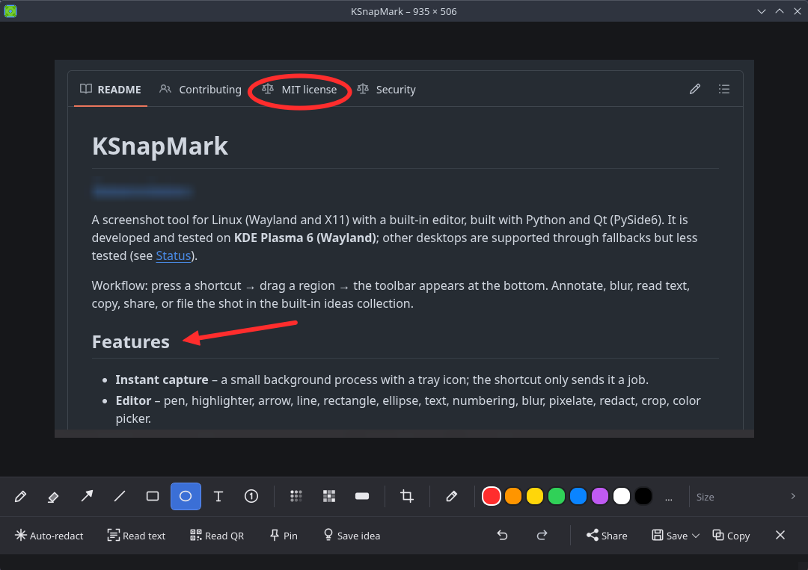

# KSnapMark

[English version](README.md)

Screenshot-Werkzeug für Linux (Wayland und X11), gebaut mit Python und Qt (PySide6).

Ablauf: Tastenkombination drücken → Bereich aufziehen → unten erscheint die Werkzeugleiste.
Markieren, schwärzen, Text auslesen, kopieren, teilen oder in die Ideen-Sammlung legen.



## Installation (Arch Linux)

```bash
# Pflicht
sudo pacman -S pyside6

# Bildschirmaufnahme: KDE Plasma braucht nichts weiter (KWin- und Portal-Schnittstelle sind eingebaut).
# Auf anderen Desktops oder als Rückfall eines davon:
sudo pacman -S grim              # Sway, Hyprland und andere wlroots-Compositor
sudo pacman -S spectacle         # KDE Plasma (Rückfall)
sudo pacman -S gnome-screenshot  # GNOME
sudo pacman -S maim              # X11

# Empfohlen
sudo pacman -S wl-clipboard      # Wayland: Kopiertes bleibt nach dem Schließen erhalten
sudo pacman -S xclip             # X11: dasselbe
sudo pacman -S tesseract tesseract-data-deu tesseract-data-eng   # Text auslesen
sudo pacman -S libnotify         # Benachrichtigungen
sudo pacman -S zbar              # QR-Codes und Strichcodes lesen (Alternative: python-opencv, nur QR)
sudo pacman -S ffmpeg            # Videos in GIFs umwandeln

./install.sh
ksnapmark --doctor                # zeigt, was noch fehlt
```

`install.sh` legt alles unter `~/.local` ab: kein sudo, kein Eingriff ins System. Es richtet
den Autostart ein und startet KSnapMark sofort im Hintergrund.
`./install.sh --no-autostart` lässt den Autostart weg, `./install.sh --uninstall` entfernt alles
(die Ideen-Sammlung bleibt).

## Hintergrundbetrieb und Tray-Symbol

KSnapMark läuft im Hintergrund und zeigt ein Symbol in der Systemleiste – so siehst du, dass es
aktiv ist. Ein Aufruf per Tastenkürzel schickt nur noch einen Auftrag an diesen Prozess, die
Aufnahme startet dadurch deutlich schneller. Das Symbol:

- **Klick** startet eine Aufnahme, **Rechtsklick** öffnet das Menü (Bereich, ganzer Bildschirm,
  Text per OCR, Ideen-Sammlung, „Beim Anmelden starten“, Beenden).
- Drückst du das Kürzel noch einmal, während der Auswahlbildschirm offen ist, bricht das die Aufnahme ab.

Befehle: `ksnapmark --daemon` (nur im Hintergrund starten) · `ksnapmark --quit` (beenden) ·
`ksnapmark --standalone` (ein Aufruf = ein Prozess, ohne Hintergrund). Dauerhaft ohne Hintergrundbetrieb:
`resident = false` in der Konfiguration.

## Bildschirmaufnahme ohne Zusatzprogramme

KSnapMark probiert die Verfahren der Reihe nach, das erste funktionierende gewinnt
(KDE: KWin → Spectacle → grim → Portal):

1. **KWin-Schnittstelle** (KDE): jeder Monitor einzeln in nativer Auflösung, kein Dialog.
   KWin gibt sie nur freigegebenen Programmen; sonst fällt KSnapMark automatisch zurück.
2. **Desktop-Portal** (KDE, GNOME, wlroots): gesamter Desktop; je nach Desktop erscheint einmal eine Rückfrage.
3. **Hilfsprogramme**: Spectacle, grim, gnome-screenshot, maim, scrot, import.

`ksnapmark --doctor` testet jedes Verfahren einzeln und zeigt Dauer und Fehler.
Ein bestimmtes erzwingen: `capture_backend = "kwin"` (oder `portal`, `spectacle`, `grim` …) in der Konfiguration.

### Als Arch-Paket (statt install.sh)

`packaging/PKGBUILD` baut ein normales Paket aus dem Release-Archiv auf GitHub. Es taucht in `pacman -Q` auf und lässt
sich sauber entfernen:

```bash
git clone https://github.com/artemus75/ksnapmark
cd ksnapmark/packaging
makepkg -si            # mit -f wird neu gebaut, auch wenn schon ein Paket derselben Version existiert
```

Das Paket legt den Autostart-Eintrag nach `/etc/xdg/autostart` (im Tray-Menü abschaltbar) und das Icon ins hicolor-Theme.
Wurde vorher per `install.sh` installiert, zuerst `./install.sh --uninstall`. Ein AUR-Paket (`yay -S ksnapmark`) folgt,
sobald die AUR-Registrierung wieder möglich ist.

## Tastenkombination festlegen

Auf Wayland dürfen Programme keine globalen Tastenkürzel selbst anlegen – das macht der
Compositor bzw. Desktop. Lege die Kombination auf den Befehl `ksnapmark`:

| Umgebung | Eintrag |
|---|---|
| Hyprland | `bind = , Print, exec, ksnapmark` |
| Sway | `bindsym Print exec ksnapmark` |
| i3 (X11) | `bindsym Print exec --no-startup-id ksnapmark` |
| GNOME | Einstellungen → Tastatur → Tastenkürzel → Eigene Tastenkürzel → Befehl `ksnapmark` |
| KDE Plasma | Systemeinstellungen → Tastenkürzel → Eigene Kürzel → Befehl `ksnapmark` |

Belegt der Desktop `Druck` schon (GNOME, Spectacle), dort das Standardkürzel ändern oder eine
andere Kombination wählen, z. B. `Super+Shift+S`.

Weitere nützliche Kürzel:

```
ksnapmark --ocr      # Bereich markieren → Text direkt in die Zwischenablage
ksnapmark --copy     # Bereich markieren → sofort kopieren, ohne Editor
ksnapmark --qr       # Bereich markieren → QR-/Strichcode lesen, Inhalt in die Zwischenablage
ksnapmark --pin      # Bereich markieren → als schwebendes Bild anheften
ksnapmark --scroll   # Bereich markieren → Inhalt scrollen, die Bilder werden zu einem langen Bild verbunden
ksnapmark --record region   # Video aufnehmen (region | window | screen), braucht Spectacle ab Plasma 6
ksnapmark --gif VIDEO       # Video in ein GIF umwandeln (ffmpeg)
ksnapmark --settings        # Einstellungen
ksnapmark --ideas    # Ideen-Sammlung öffnen
ksnapmark --full     # ganzer Bildschirm
ksnapmark --delay 3  # mit 3 s Verzögerung (z. B. für Menüs)
```

## Bedienung

**Bereichsauswahl:** Maus ziehen · `Leertaste` ganzer Bildschirm · `Esc` / Rechtsklick abbrechen ·
`L` schaltet eine **Lupe** neben dem Zeiger ein/aus (vergrößerter
Bildausschnitt mit Farbwert und Position; standardmäßig aus, siehe `show_loupe`), `C` kopiert die Farbe unter dem Mauszeiger (Hex). Unter **KDE Plasma** kannst du statt Aufziehen ein
**Fenster anklicken**: es wird beim Darüberfahren hervorgehoben, Ziehen überschreibt das jederzeit.

**Editor** (Werkzeugleiste unten, Kürzel in Klammern):
Auswählen (V) · Stift (P) · Textmarker (M) · Pfeil (A) · Linie (L) · Rechteck (R) · Ellipse (E) · Text (T) ·
Nummerierung (N) · Weichzeichnen (B) · Verpixeln (K) · Schwärzen (X) · Zuschneiden (C) · Pipette (I).
`Shift` beim Ziehen = gerade Linie in 45°-Schritten bzw. Quadrat/Kreis.

Anmerkungen bleiben bearbeitbar: Mit dem Werkzeug **Auswählen** (V) ein Element anklicken, verschieben, an den Griffen skalieren, Farbe, Stärke oder Füllung in der Leiste ändern, mit den Pfeiltasten verschieben (`Shift` = 10 px), Text per Doppelklick bearbeiten und mit `Entf` löschen. Weichzeichnen, Verpixeln und Schwärzen sind ebenfalls nicht destruktiv – beim Verschieben kommen die Pixel darunter zurück. `Esc` hebt die Auswahl auf.

| Aktion | Kürzel |
|---|---|
| Kopieren und schließen | `Enter` |
| Kopieren | `Strg+C` |
| Speichern (nach `~/Pictures/Screenshots`) | `Strg+S` |
| Speichern unter | `Strg+Shift+S` |
| Rückgängig / Wiederholen | `Strg+Z` / `Strg+Y` |
| Text auslesen | `Strg+T` |
| Automatisch unkenntlich machen (Namen, Begriffe, Sensibles) | `Strg+Shift+R` |
| QR-/Strichcode lesen | `Strg+Shift+Q` |
| Bild anheften (schwebend) | `Strg+P` |
| In Ideen-Sammlung speichern | `Strg+I` |
| Zoom | `Strg+Mausrad` |
| Schließen | `Esc` |

## Besondere Funktionen

- **Automatisch unkenntlich machen** (`Strg+Shift+R`): Du tippst Namen oder Begriffe ein (einer pro Zeile,
  z. B. `Max Mustermann`), KSnapMark findet sie per Texterkennung im Bild und legt den gewählten Effekt
  darüber: **Weichzeichnen** (Voreinstellung), Verpixeln oder Schwärzen. Groß-/Kleinschreibung, Umlaute
  (Müller = Mueller) und kleine Lesefehler sind egal; auf Wunsch werden auch Namensteile gefunden
  (nur der Nachname, auch in E-Mail-Adressen). Zusätzlich erkennt es typische Muster: E-Mail-Adressen, IBANs
  (mit Prüfsumme), IP-Adressen, Telefonnummern, Kartennummern (Luhn), API-Schlüssel/Tokens und Zeilen wie
  `password: …`. Die Stärke des Weichzeichnens richtet sich nach der Schrifthöhe. Danach liest KSnapMark das
  Ergebnis noch einmal per Texterkennung und schwärzt zusätzlich alles, was noch lesbar wäre. Nicht gefundene
  Begriffe werden gemeldet. Die eingegebenen Begriffe bleiben nur im Arbeitsspeicher (bis KSnapMark beendet
  wird), nicht auf der Platte. **Optional** gibt es eine dauerhafte Liste (z. B. dein Name oder deine Firma), die bei jeder
  Aufnahme mitgesucht wird: im Dialog „Dauerhafte Liste verwenden“ ankreuzen. Sie liegt unverschlüsselt in
  `~/.config/ksnapmark/redact_terms.txt` (nur für dich lesbar); Liste leeren löscht die Datei. **Prüfe das Ergebnis trotzdem immer vor dem Teilen** – Texterkennung kann Stellen
  übersehen (Logos, Handschrift, sehr kleine oder verzerrte Schrift).
- **Text auslesen:** Tesseract-OCR (Deutsch und Englisch), Ergebnis lässt sich vor dem Kopieren
  korrigieren.
- **Ideen-Sammlung:** Screenshot mit Titel, Tags, Quelle (Link) und Notiz speichern.
  Der Text im Bild wird im Hintergrund miterfasst, die Suche findet ihn also auch.
  Bilder und Datenbank liegen unter `~/.local/share/ksnapmark/`. Aus der Zwischenablage lassen sich
  Bilder per `Strg+V` direkt hinzufügen. Gespeicherte Ideen kannst du jederzeit nachbearbeiten.
- **Zwischenablage sofort:** Ein neuer Screenshot liegt schon in der Zwischenablage, wenn sich der Editor öffnet –
  du kannst ihn direkt einfügen. Erst nach dem Bearbeiten auf *Kopieren* klicken (oder `Enter`).
  Abschaltbar mit `auto_copy = false`.
- **Teilen:** Bild oder Dateipfad kopieren, per E-Mail senden, mit anderem Programm öffnen oder
  hochladen. Upload-Ziele: `0x0.st` (oder ein 0x0-kompatibler Server, siehe `upload_url`), `catbox.moe` (dauerhaft) und
  `uguu.se` (temporär). Der Upload erzeugt einen **öffentlichen** Link und fragt deshalb vorher nach.

- **Spotlight (`S`):** dunkelt alles außerhalb des gezogenen Rahmens ab, um den Blick auf einen Bereich zu lenken.
- **Rahmen (Werkzeugleiste):** setzt das Bild auf einen Verlauf oder eine Farbfläche mit runden Ecken und weichem Schatten.
- **Pipette (`I`):** Klick ins Bild übernimmt die Farbe als Zeichenfarbe und kopiert den Hex-Wert.
- **QR-Code lesen:** findet QR- und Strichcodes im Bild (mit `zbar`; ohne zbar nur QR über OpenCV).
  Links werden erst nach Klick auf „Link öffnen“ geöffnet; WLAN-Codes zeigen Netzwerk und Passwort getrennt.
- **Anheften:** Das Bild schwebt als rahmenloses Fenster über dem Desktop (Referenz beim Arbeiten).
  Ziehen verschiebt, Mausrad ändert die Größe, `Strg`+Mausrad die Transparenz, Doppelklick schließt.
  Ob es *über allen* Fenstern bleibt, entscheidet unter Wayland der Desktop – in KDE: `Alt+F3` →
  „Weitere Aktionen“ → „Immer im Vordergrund halten“.
- **Verlauf:** Die letzten Aufnahmen (Voreinstellung 10) erreichst du im Tray-Menü unter „Verlauf“, auch wenn
  du den Editor zu früh geschlossen hast. Sie liegen als Dateien in `~/.local/share/ksnapmark/history`
  (nur für dich lesbar); abschaltbar, in der Größe einstellbar und per Knopf leerbar. **Suche:** Tray-Menü →
  Verlauf → „Verlauf durchsuchen …“ (oder `ksnapmark --history`) zeigt Vorschaubilder und filtert sie beim Tippen.
  Der Text der Bilder wird im Hintergrund mit Tesseract erkannt und in einer Indexdatei neben den Bildern abgelegt
  (`index.json`, nur für dich lesbar, verlässt den Computer nie); abschaltbar mit `history_ocr = false`.
- **Bildschirmaufnahme:** Video über Spectacle (`ksnapmark --record region|window|screen`, Tray-Menü
  „Bildschirmaufnahme“). Beendet wird die Aufnahme über das Spectacle-Symbol in der Systemleiste. Auf Wunsch
  legt KSnapMark automatisch ein GIF daneben (Einstellungen, braucht `ffmpeg`); vorhandene Videos wandelt
  „Video in GIF umwandeln …“ um.
- **Sprachen:** Deutsch und Englisch; die Oberfläche folgt der Systemsprache und lässt sich in den Einstellungen festlegen.
- **Einstellungen:** Tray-Menü → „Einstellungen …“ (oder `ksnapmark --settings`) statt `config.toml` von Hand.

### Blur oder Schwärzen?

Weichzeichnen und Verpixeln sind rechnerisch umkehrbar schwer, aber bei kleiner Schrift und
schwachem Effekt nicht immer sicher. Für Passwörter, Kontonummern und Ähnliches das
**Schwärzen**-Werkzeug nehmen: es deckt vollständig ab. Alle Effekte werden fest ins Bild
gerechnet – im gespeicherten oder kopierten Bild liegt nichts Verdecktes darunter.

## Konfiguration (optional)

`~/.config/ksnapmark/config.toml`:

```toml
save_dir = "~/Pictures/Screenshots"
ocr_langs = "deu+eng"
upload_url = "https://0x0.st"
upload_expires_hours = 24
capture_backend = "auto"   # auto | kwin | portal | spectacle | grim | gnome-screenshot | maim
resident = true            # false = kein Hintergrundprozess/Tray
history = true             # Verlauf im Tray-Menü
history_size = 10
history_ocr = true          # Text der Verlaufsbilder für die Suche indexieren
snap_windows = true        # KDE: Fenster anklicken
record_dir = "~/Videos"
record_format = "webm"     # webm | mp4
record_gif = false
language = "auto"          # auto (Systemsprache) | en | de
auto_copy = true            # eine neue Aufnahme liegt sofort in der Zwischenablage
show_loupe = false         # Lupe mit Farbwert bei der Bereichsauswahl (Umschalten mit L)
include_cursor = false     # Mauszeiger mit aufnehmen (KWin, Spectacle, grim, gnome-screenshot, scrot; nicht das Portal)
```

## Fehlersuche

- `ksnapmark --doctor` listet Sitzungstyp, Monitore und fehlende Pakete.
- `ksnapmark --selftest` testet alles ausführlich (Aufnahme, Tray, Fenster-Einrasten, Videoaufnahme) und schreibt
  den Bericht nach `~/ksnapmark-selftest.txt` – praktisch, um ihn weiterzugeben. Fenstertitel stehen nicht darin.
- „Aufnahme fehlgeschlagen“: der Dialog nennt für jedes versuchte Verfahren den Grund; `ksnapmark --doctor` zeigt mehr.
- Kein Symbol in der Leiste: Systemleiste noch nicht bereit (KSnapMark versucht es einige Sekunden lang erneut)
  oder der Desktop hat keine – die Aufnahme per Kürzel funktioniert trotzdem.
- Auswahlbildschirm reagiert nicht auf `Esc`: Rechtsklick oder nochmal das Kürzel bricht ab; zur Not
  `ksnapmark --standalone` als Kürzel eintragen.
- Mehrere Monitore: KSnapMark nimmt den Monitor unter dem Mauszeiger; unter Wayland kennt es dessen
  Position nicht immer – dann mit `ksnapmark --screen NAME` festlegen (Namen zeigt `--doctor`).
- Kopiertes Bild ist nach dem Schließen weg: `wl-clipboard` (Wayland) bzw. `xclip` (X11) fehlt.
  Ohne diese Pakete bleibt KSnapMark unsichtbar im Hintergrund, bis etwas anderes kopiert wird.
