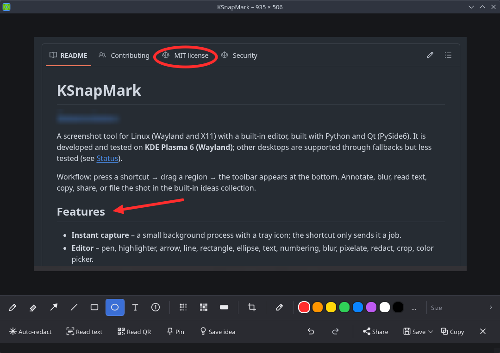

# KSnapMark

[Deutsche Version](README.de.md)

A screenshot tool for Linux (Wayland and X11) with a built-in editor, built with Python and Qt (PySide6).
It is developed and tested on **KDE Plasma 6 (Wayland)**; other desktops are supported through fallbacks but less
tested (see [Status](#status)).

Workflow: press a shortcut → drag a region → the toolbar appears at the bottom. Annotate, blur, read text,
copy, share, or file the shot in the built-in ideas collection.



## Features

- **Clipboard right away** – a new screenshot is already in the clipboard when the editor opens; paste it anywhere,
  click *Copy* (or press `Enter`) only after editing.
- **Instant capture** – a small background process with a tray icon; the shortcut only sends it a job.
- **Editor** – pen, highlighter, arrow, line, rectangle, ellipse, text, numbering, blur, pixelate, redact, crop, color picker.
- **Auto-redact** – type names or terms (e.g. `Max Mustermann`); KSnapMark finds them via OCR and blurs them.
  It also detects e-mail addresses, IBANs, IP addresses, phone numbers, card numbers, API keys and `password: …` lines,
  and re-scans the result to catch anything still readable.
- **OCR** (Tesseract), **QR / barcode reading**, **pin to screen**, **scrolling capture** (you scroll, KSnapMark stitches), **magnifier with color picker**.
- **Window snapping** (KDE): click a window instead of dragging.
- **Screen recording** via Spectacle, optional GIF conversion (ffmpeg).
- **History** of the last captures, with a **text search** over what is written in the screenshots.
- **Frame & shadow**, **spotlight** and more in the editor; **scrolling capture** for long pages.
- **Ideas collection** – searchable library of screenshots with title, tags, source link and notes
  (the text inside the image is indexed, too).
- **Share** – copy, e-mail, open with another app, or upload to 0x0.st, catbox.moe or uguu.se (creates a *public* link, asks first).

## Installation

### Arch Linux

```bash
# required
sudo pacman -S pyside6

# optional
sudo pacman -S tesseract tesseract-data-deu tesseract-data-eng   # OCR and auto-redact
sudo pacman -S wl-clipboard      # Wayland: clipboard content survives closing the editor
sudo pacman -S xclip             # X11: same
sudo pacman -S libnotify         # notifications
sudo pacman -S zbar              # read QR codes and barcodes (alternative: python-opencv, QR only)
sudo pacman -S ffmpeg            # convert recordings to GIF
# capture fallbacks outside KDE (KDE needs nothing extra):
sudo pacman -S grim              # Sway, Hyprland and other wlroots compositors
sudo pacman -S spectacle         # KDE fallback
sudo pacman -S gnome-screenshot  # GNOME
sudo pacman -S maim              # X11

./install.sh
ksnapmark --doctor               # shows what is still missing
```

`install.sh` installs everything below `~/.local` (no sudo, no changes to the system), sets up autostart and
starts KSnapMark in the background. `./install.sh --no-autostart` skips autostart, `./install.sh --uninstall` removes
everything (your ideas collection stays).

### As an Arch package (instead of install.sh)

`packaging/PKGBUILD` builds a regular package from the GitHub release archive. It shows up in `pacman -Q` and can be
removed cleanly:

```bash
git clone https://github.com/artemus75/ksnapmark
cd ksnapmark/packaging
makepkg -si            # use -f to force a rebuild if a package of the same version exists
```

Optional dependencies are listed by `pacman -Qi ksnapmark`. The package puts the autostart entry in
`/etc/xdg/autostart` (it can be switched off from the tray menu) and the icon into the hicolor theme.
If you installed via `install.sh` before, run `./install.sh --uninstall` first. An AUR package (`yay -S ksnapmark`) is
planned once AUR registration is possible again.

### Upgrading from "SnapMark"

KSnapMark was previously called SnapMark. Running `./install.sh` removes the old installation, and your settings,
ideas collection and history are moved to the new folders (`~/.config/ksnapmark`, `~/.local/share/ksnapmark`) on first start.

## Background process and tray icon

KSnapMark keeps running in the background and shows a tray icon, so you can see that it is active. Calling it via
shortcut only sends a job to that process, which makes capturing much faster.

- **Click** the icon to start a capture, **right-click** for the menu (region, full screen, text via OCR, QR code,
  pin, screen recording, ideas collection, history, settings, start at login, quit).
- Pressing the shortcut again while the selection screen is open cancels the capture.

Commands: `ksnapmark --daemon` (start in background only) · `ksnapmark --quit` (stop) ·
`ksnapmark --standalone` (one call = one process, no background). To disable the background process permanently,
set `resident = false` in the configuration.

## How the screen is captured

KSnapMark tries the methods in order and uses the first one that works (KDE: KWin → Spectacle → grim → portal):

1. **KWin interface** (KDE): every monitor separately at native resolution, no dialog. KWin only allows authorized
   programs; otherwise KSnapMark falls back automatically.
2. **Desktop portal** (KDE, GNOME, wlroots): the whole desktop; some desktops show a one-time prompt.
3. **Helper programs**: Spectacle, grim, gnome-screenshot, maim, scrot, import (the X11-only tools are skipped on Wayland).

`ksnapmark --doctor` tests each method and shows timing and errors.
To force one: `capture_backend = "kwin"` (or `portal`, `spectacle`, `grim` …) in the configuration.

## Setting a keyboard shortcut

On Wayland, programs cannot register global shortcuts themselves – the compositor or desktop does that.
Bind your key to the command `ksnapmark`:

| Environment | Entry |
|---|---|
| Hyprland | `bind = , Print, exec, ksnapmark` |
| Sway | `bindsym Print exec ksnapmark` |
| i3 (X11) | `bindsym Print exec --no-startup-id ksnapmark` |
| GNOME | Settings → Keyboard → Shortcuts → Custom Shortcuts → command `ksnapmark` |
| KDE Plasma | System Settings → Shortcuts → Custom Shortcuts → command `ksnapmark` |

If the desktop already uses `Print` (GNOME, Spectacle), change that default or pick another key, e.g. `Super+Shift+S`.

More useful commands for shortcuts:

```
ksnapmark --ocr             # select a region → text goes straight to the clipboard
ksnapmark --copy            # select a region → copy immediately, no editor
ksnapmark --qr              # select a region → read QR/barcode, content to the clipboard
ksnapmark --pin             # select a region → pin as a floating image
ksnapmark --scroll          # select a region → scroll the content, frames are stitched into one image
ksnapmark --record region   # record video (region | window | screen), needs Spectacle from Plasma 6
ksnapmark --gif VIDEO       # convert a video to GIF (ffmpeg)
ksnapmark --settings        # settings dialog
ksnapmark --ideas           # open the ideas collection
ksnapmark --full            # full screen
ksnapmark --delay 3         # capture after 3 s (e.g. for menus)
```

## Usage

**Region selection:** drag with the mouse · `Space` full screen · `Esc` / right-click cancel · `L` toggles a **magnifier**
next to the cursor (enlarged area, color value, position; off by default, see `show_loupe`), and `C` copies the color
under the cursor (hex).
On **KDE Plasma** you can **click a window** instead of dragging: it is highlighted on hover, and dragging always overrides it.

**Editor** (toolbar at the bottom, shortcuts in brackets):
Select (V) · Pen (P) · Highlighter (M) · Arrow (A) · Line (L) · Rectangle (R) · Ellipse (E) · Text (T) · Numbering (N) ·
Blur (B) · Pixelate (K) · Redact (X) · Crop (C) · Color picker (I).
Hold `Shift` while dragging for straight lines in 45° steps, or squares/circles.

Annotations stay editable: with the **Select** tool (V) click an item to move it, drag its handles to resize, change color, width or fill in the toolbar, nudge with the arrow keys (`Shift` = 10 px), double-click text to edit it and press `Del` to remove it. Blur, pixelate and redact are non-destructive too – move them and the pixels underneath come back. `Esc` clears the selection.

| Action | Shortcut |
|---|---|
| Copy and close | `Enter` |
| Copy | `Ctrl+C` |
| Save (to `~/Pictures/Screenshots`) | `Ctrl+S` |
| Save as | `Ctrl+Shift+S` |
| Undo / redo | `Ctrl+Z` / `Ctrl+Y` |
| Read text (OCR) | `Ctrl+T` |
| Auto-redact (names, terms, sensitive data) | `Ctrl+Shift+R` |
| Read QR / barcode | `Ctrl+Shift+Q` |
| Pin image (floating) | `Ctrl+P` |
| Save to ideas collection | `Ctrl+I` |
| Zoom | `Ctrl+mouse wheel` |
| Close | `Esc` |

## Feature details

- **Auto-redact** (`Ctrl+Shift+R`): type names or terms (one per line, e.g. `Max Mustermann`). KSnapMark finds them
  with OCR and applies the chosen effect: **blur** (default), pixelate or redact. Upper/lower case, umlauts
  (Müller = Mueller) and small OCR errors do not matter; optionally name parts are found as well (surname only, also
  inside e-mail addresses). It also recognizes common patterns: e-mail addresses, IBANs (with checksum), IP addresses,
  phone numbers, card numbers (Luhn), API keys/tokens and lines such as `password: …`. Blur strength follows the text
  height. Afterwards KSnapMark runs OCR on the result again and redacts anything that would still be readable.
  Terms that were not found are reported. Entered terms stay in memory only (until KSnapMark quits). **Optionally** there
  is a persistent list (e.g. your own name or company) that is searched on every capture: tick "Use persistent list"
  in the dialog. It is stored unencrypted in `~/.config/ksnapmark/redact_terms.txt` (readable only by you); clearing
  the list deletes the file. **Always check the result before sharing** – OCR can miss things (logos, handwriting,
  very small or distorted text).
- **Read text:** Tesseract OCR (German and English by default); you can correct the result before copying.
- **Ideas collection:** save a screenshot with title, tags, source (link) and note. The text in the image is indexed in
  the background, so search finds it, too. Images and the database live in `~/.local/share/ksnapmark/`. Images from
  the clipboard can be added with `Ctrl+V`. Saved ideas can be edited at any time.
- **Share:** copy the image or its file path, send by e-mail, open with another program, or upload. Upload targets: `0x0.st` (or any
  0x0-compatible server, see `upload_url`), `catbox.moe` (permanent) and `uguu.se` (temporary). The upload creates a
  **public** link and therefore asks first.
- **Spotlight (`S`):** dims everything outside the box you draw, to draw attention to one area.
- **Frame (toolbar):** puts the image on a gradient or flat background with rounded corners and a soft shadow.
- **Color picker (`I`):** a click in the image takes the color as drawing color and copies the hex value.
- **Read QR codes:** finds QR codes and barcodes in the image (with `zbar`; without it only QR via OpenCV). Links are
  opened only after you click "Open link"; Wi-Fi codes show network and password separately.
- **Pin:** the image floats as a frameless window above the desktop (reference while working). Drag to move, mouse wheel
  to resize, `Ctrl`+wheel for transparency, double-click to close. Whether it stays *on top* of other windows is up to
  the desktop on Wayland – in KDE: `Alt+F3` → "More Actions" → "Keep Above Others".
- **History:** the last captures (default 10) are available in the tray menu under "History", even if you closed the
  editor too early. They are stored as files in `~/.local/share/ksnapmark/history` (readable only by you); the feature
  can be switched off, resized, and cleared with one button. **Search:** tray menu → History → "Search history …"
  (or `ksnapmark --history`) shows thumbnails and filters them while you type. The text of the images is recognized in
  the background with Tesseract and kept in an index file next to the images (`index.json`, readable only by you,
  never leaves your computer); switch it off with `history_ocr = false`.
- **Screen recording:** video via Spectacle (`ksnapmark --record region|window|screen`, tray menu "Screen recording").
  Stop the recording with the Spectacle icon in the system tray. Optionally KSnapMark creates a GIF next to it
  (settings, needs `ffmpeg`); "Convert video to GIF …" converts existing videos.
- **Languages:** English and German; chosen from the system language, changeable in the settings.
- **Settings:** tray menu → "Settings …" (or `ksnapmark --settings`) instead of editing `config.toml` by hand.

### Blur or redact?

Blur and pixelate are hard to reverse, but with small text and a weak effect they are not always safe. For passwords,
account numbers and the like, use the **Redact** tool: it covers completely. All effects are baked into the image –
the saved or copied image contains nothing hidden underneath.

## Configuration (optional)

`~/.config/ksnapmark/config.toml`:

```toml
save_dir = "~/Pictures/Screenshots"
ocr_langs = "deu+eng"
upload_url = "https://0x0.st"
upload_expires_hours = 24
capture_backend = "auto"   # auto | kwin | portal | spectacle | grim | gnome-screenshot | maim
resident = true            # false = no background process / tray
history = true             # history in the tray menu
history_size = 10
history_ocr = true          # index the text of history images for the search
snap_windows = true        # KDE: click a window
record_dir = "~/Videos"
record_format = "webm"     # webm | mp4
record_gif = false
language = "auto"          # auto (follow the system) | en | de
auto_copy = true            # a new capture is put into the clipboard right away
show_loupe = false         # magnifier with color value during region selection (toggle with L)
include_cursor = false     # also capture the mouse pointer (KWin, Spectacle, grim, gnome-screenshot, scrot; not the portal)
```

## Troubleshooting

- `ksnapmark --doctor` lists session type, monitors and missing packages.
- `ksnapmark --selftest` tests everything in depth (capture, tray, window snapping, recording) and writes the report to
  `~/ksnapmark-selftest.txt` – handy for bug reports. Window titles are not included.
- "Capture failed": the dialog names the reason for each method tried; `ksnapmark --doctor` shows more.
- No tray icon: the system tray may not be ready yet (KSnapMark retries for a few seconds) or the desktop has none –
  capturing via shortcut still works.
- Selection screen ignores `Esc`: right-click or pressing the shortcut again cancels; as a last resort bind
  `ksnapmark --standalone` to your shortcut.
- Multiple monitors: KSnapMark uses the monitor under the pointer; on Wayland it does not always know its position –
  then set it with `ksnapmark --screen NAME` (names are shown by `--doctor`).
- Copied image disappears after closing: `wl-clipboard` (Wayland) or `xclip` (X11) is missing.

## Status

- Developed and tested on **Arch Linux, KDE Plasma 6 (Wayland)**.
- GNOME, Sway, Hyprland and X11 are covered by the fallback paths and by simulated tests, but not yet verified on real
  systems. Reports are very welcome – run `ksnapmark --selftest` and attach the report to an issue.
- The user interface is available in **English and German**. It follows the system language (`LANG`); you can force a
  language in Settings → Language or with `language = "en"` / `"de"` in `config.toml`. See [CONTRIBUTING.md](CONTRIBUTING.md)
  for adding another language.

## Third-party software

KSnapMark uses PySide6/Qt (LGPL) and optionally Tesseract, zbar, OpenCV, ffmpeg, Spectacle and other tools through their
command line or Python interfaces; none of them is bundled. The default upload service is the third-party `0x0.st`.
The application icon (`ksnapmark/data/ksnapmark.svg`) is original artwork under the same MIT license.

## Development

```bash
pip install PySide6 pillow qrcode dbus-next opencv-python-headless   # test dependencies
python tests/run_all.py                                               # runs everything offscreen
```

See [CONTRIBUTING.md](CONTRIBUTING.md) and [SECURITY.md](SECURITY.md) (privacy notes). Licensed under the [MIT License](LICENSE).
